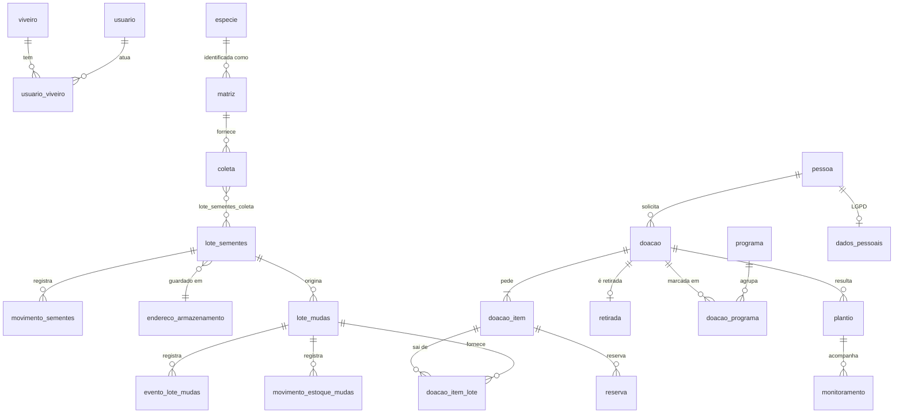

# CRADS — Modelo de dados

> Estado: **proposta, aguardando aprovação**. Itens com **[hipótese]** dependem
> da `especificacao.md` e da tabela de sementes e mudas, que ainda não chegaram.

## 0. Convenções

Todo registro sincronizável tem estes campos de controle (omitidos nas tabelas abaixo):

| Campo | Uso |
|---|---|
| `id` | 15 caracteres, gerado no aparelho e nunca muda |
| `versao` | inteiro, sobe a cada alteração (controle de conflito) |
| `seq` | contador do servidor para o “puxar alterações” |
| `criado_por`, `atualizado_por` | usuário |
| `criado_no_aparelho_em`, `criado_em`, `atualizado_em` | data de quando foi feito em campo e datas do servidor |
| `dispositivo_id` | aparelho de origem |
| `excluido` | exclusão lógica; nada é apagado de verdade |
| `viveiro_id` | presente em tudo que é separado por viveiro |

Quantidades de sementes ficam em **gramas** e/ou **unidades estimadas**. Mudas
ficam sempre em **unidades**.

## 1. Cadeia de rastreio (o “fio” do lote)

```
Matriz MT-0123 ─┐
Matriz MT-0130 ─┼─ Coletas ──► Lote de sementes LS-2026-045 ──► Lote de mudas LM-2026-045-A ──► Item de doação ──► Doação DO-2026-310 ──► Plantio ──► Monitoramentos
Matriz MT-0141 ─┘   (N:N via lote_sementes_coleta)        └──► Lote de mudas LM-2026-045-B
```

- Um lote de sementes junta coletas de **várias matrizes da mesma espécie**.
  Isso é o que garante a diversidade genética.
- Um lote de mudas vem de **um** lote de sementes. A letra (A, B, C…)
  identifica cada semeadura do mesmo lote de sementes.
- Uma doação pode levar mudas de vários lotes. `doacao_item_lote` registra
  qual lote saiu.
- **Volta às matrizes:** plantio → doação → `doacao_item_lote` → lote de
  mudas → lote de sementes → `lote_sementes_coleta` → coleta → matriz. Uma
  consulta pronta (`rastrear(codigo)`) faz o caminho nos dois sentidos.
- Formatos: `MT-0000` (sequência única do órgão), `LS-AAAA-NNN`,
  `LM-AAAA-NNN-X` (herda o número do LS), `DO-AAAA-NNN`. As sequências são
  globais e não separadas por viveiro **[hipótese]**. O viveiro é um campo.

## 2. Diagrama (resumido)



## 3. Organização, usuários e parâmetros

| Entidade | Campos principais |
|---|---|
| `instalacao` (registro único) | nome do órgão, UF padrão (`TO`), logotipo, cabeçalho e textos do termo e do ofício. Permite que outro município ou estado use o sistema. |
| `viveiro` | `sigla` (PAL, GUR), nome, `municipio_id`, endereço, ativo |
| `municipio` | código IBGE, nome, UF, `biomas[]`, contorno simplificado (para mapa e pacote de campo) |
| `usuario` (autenticação PocketBase) | nome, login/e-mail, ativo, `gestor_geral` (vê todos os viveiros), `pessoa_id` |
| `usuario_viveiro` | usuário, viveiro, `perfil` (coletor, viveirista, gestor). Uma pessoa pode ter perfis diferentes em viveiros diferentes. |
| `pessoa` | nome, tipo (física ou jurídica), instituição, município. É usada para solicitante, proprietário de área e recebedor. |
| `dados_pessoais` | `pessoa_id`, CPF/CNPJ, telefone, e-mail. **Só o gestor lê.** |
| `parametro` | `chave`, `valor` (JSON), `viveiro_id` (vazio quando é geral), editado pelo gestor e auditado. Exemplos: `meta_matrizes_por_especie=12`, `min_matrizes_por_lote`, `distancia_min_matrizes_m`, `prazo_retirada_dias`, `limite_mudas_por_pedido`, `perfis_aprovadores=["gestor"]`, `dias_sessao_offline`. |
| `meta` | indicador, alvo, ano, recorte (viveiro, espécie ou programa) |
| `dispositivo` | usuário, nome, última sincronização, versão do pacote de campo |
| `faixa_codigo` | dispositivo, tipo (MT, LS, LM, DO), ano, início, fim, último usado |
| `sequencia_codigo` | tipo, ano, próximo número (só no servidor) |

## 4. Espécies e assistente de identificação

| Entidade | Campos principais |
|---|---|
| `especie` | `nome_cientifico` (aceito), autor, família, `flora_id` (ID na Flora e Funga do Brasil), forma de vida, endemismo, **caracteres de campo** (folha, disposição, látex, espinhos, casca, flor, fruto, como texto curto), fenologia (`meses_flor[]`, `meses_fruto[]`), `lorenzi_volume`, `lorenzi_pagina`, `ficticia` (marca os exemplos de teste), `publicada` (aparece no catálogo). **Dados de sementes e mudas** (sementes/kg, dormência, tratamento, tempo de germinação, tempo até a muda ficar pronta, grupo sucessional…) **[hipótese: definir pela tabela de sementes e mudas]**. |
| `sinonimo` | espécie, nome |
| `nome_popular` | espécie, nome, região |
| `especie_ocorrencia` | espécie, UF, bioma, origem (`flora_funga` ou `manual`) |
| `especie_municipio` | espécie, município (lista curada, opcional; usada no pacote de campo) |
| `especie_confusao` | espécie A, espécie B, “como diferenciar” |
| `especie_foto` | espécie, parte (folha, casca, flor, fruto, semente, árvore inteira, muda), arquivo, miniatura, crédito, licença |
| `pergunta` | texto curto, parte da planta, ordem, ativa |
| `opcao` | pergunta, rótulo, figura |
| `especie_opcao` | espécie, opção. Uma espécie pode ter várias opções por pergunta (ex.: folha simples **ou** composta). |
| `importacao` | tipo (`especies_flora`, `fichas`, `estoque_inicial`), arquivo, usuário, linhas importadas e com erro, relatório de erros |

**Como o assistente funciona:** cada resposta dá pontos às espécies
compatíveis, em vez de eliminar as outras. Assim um erro de resposta não some
com a espécie certa. “Não sei” não pesa. Primeiro filtra pelo bioma e município
do GPS e pela época do ano (fenologia), depois mostra as 2 ou 3 candidatas lado
a lado com fotos. O coletor marca o grau de certeza (`certo`, `provavel` ou
`a_identificar`), e as respostas ficam salvas na matriz.

## 5. Módulo 1 — Matrizes

| Entidade | Campos principais |
|---|---|
| `matriz` | `codigo` MT-0123, `especie_id` (vazio se “a identificar”), `grau_certeza`, `metodo_identificacao` (assistente ou manual), `respostas_assistente` (JSON), viveiro, município, `lat`, `lon`, `precisao_m`, altitude, descrição do local, `proprietario_pessoa_id`, autorização do proprietário, DAP (cm), altura (m), estado da árvore, situação (ativa, inativa, morta), coletor |
| `foto` (genérica) | `entidade` + `registro_id`, parte da planta, arquivo comprimido, miniatura, `lat`/`lon` e data no momento da foto, autor, situação de envio |
| `sugestao_identificacao` | matriz, fonte (Pl@ntNet ou iNaturalist), espécie sugerida, pontuação, situação (pendente, aceita, rejeitada), revisado por. **Fase posterior**, só no servidor. |
| `rota_campo` | coletor, data, matrizes planejadas, trilha gravada (GeoJSON) |

## 6. Módulo 2 — Coleta e lotes de sementes

| Entidade | Campos principais |
|---|---|
| `coleta` | matriz, data, coletor, material (fruto ou semente), quantidade + unidade, GPS, observação |
| `lote_sementes` | `codigo` LS-2026-045, viveiro, espécie, data de formação, peso (g), nº estimado de sementes, umidade, resultado do teste de germinação, `endereco_id`, validade, situação (armazenado, em uso, esgotado, descartado). Nº de matrizes e alerta de diversidade são **calculados**. |
| `lote_sementes_coleta` | lote, coleta, quantidade que entrou |
| `endereco_armazenamento` | viveiro, local (câmara fria, sala), estante, prateleira, caixa, `codigo` legível (ex.: `PAL-C1-E2-P3-CX4`) com QR |
| `movimento_sementes` | lote, tipo (entrada, semeadura, teste, descarte, mudança de endereço, ajuste), quantidade, data, referência (lote de mudas gerado) |

## 7. Módulo 3 — Viveiro

| Entidade | Campos principais |
|---|---|
| `lote_mudas` | `codigo` LM-2026-045-A, lote de sementes, viveiro, espécie, data de semeadura, sementes semeadas (unid. ou g), recipiente (tubete, saquinho), canteiro/endereço, `fase_atual`, situação |
| `evento_lote_mudas` (só acréscimo) | tipo (semeadura, contagem de germinação, repicagem, mudança de fase, medição, perda, transferência), data, quantidade, causa da perda, altura média, fase nova, foto |
| `movimento_estoque_mudas` (livro-razão) | lote de mudas, tipo (entrada, perda, ajuste de inventário, saída por doação, transferência entre viveiros), quantidade (+/−), referência, data |
| `inventario` / `inventario_item` | viveiro, data, responsável; item: lote, contado, saldo do sistema, diferença. Ao fechar o inventário, gera os ajustes. |

Fases **[hipótese]**: semeadura → germinação → repicagem → crescimento →
rustificação → pronta.
Saldo físico = soma dos movimentos. **Disponível = físico − reservas ativas.**

## 8. Módulo 4 — Catálogo público

Não tem tabelas próprias. Usa **visões públicas** sem dados pessoais:

- Espécie publicada: ficha, fotos e mudas prontas disponíveis por viveiro.
- Rastreio do lote: LM → LS → nº de matrizes e municípios de origem.
  Sem coordenada exata, sem proprietário e sem coletor **[hipótese]**.

## 9. Módulo 5 — Doação e Plantando Água

| Entidade | Campos principais |
|---|---|
| `doacao` | `codigo` DO-2026-310, viveiro, `solicitante_pessoa_id`, instituição, finalidade, local de plantio (município, descrição, ponto ou polígono), área (ha), canal (online ou balcão), `oficio` (PDF anexado ou gerado), situação, analisado por, data da análise, justificativa, `retirar_ate` |
| `doacao_item` | doação, espécie, qtd. pedida, qtd. aprovada, qtd. entregue |
| `reserva` | item, lote de mudas, quantidade, válida até, situação (ativa, consumida, expirada, cancelada) |
| `doacao_item_lote` | item, lote de mudas, quantidade entregue (gera saída no estoque) |
| `retirada` | doação, data, nome de quem recebeu, documento (vai para `dados_pessoais`), imagem da assinatura, `termo_pdf`, entregue por, fotos |
| `programa` | nome (“Plantando Água”), ícone, cor, ativo. Fica genérico para outros programas no futuro. |
| `doacao_programa` | doação, programa, `ativo` (situação atual) |
| `doacao_programa_historico` (só acréscimo) | doação, programa, ação (marcou ou desmarcou), usuário, data, motivo |

Situações da doação: `rascunho → enviada → em_analise → aprovada | aprovada_parcial | negada → aguardando_retirada → retirada`, mais `expirada` e `cancelada`.

**Plantando Água:** o botão marca ou desmarca `doacao_programa`, e cada toque
grava uma linha no histórico. A doação continua **um único registro**, então
os totais gerais a contam uma vez só. O painel e os relatórios do programa são
os mesmos relatórios gerais com o filtro `programa = Plantando Água`.

## 10. Módulo 6 — Pós-plantio

| Entidade | Campos principais |
|---|---|
| `plantio` | doação, data, local (ponto ou polígono), município, responsável |
| `plantio_item` | plantio, espécie, quantidade plantada |
| `monitoramento` | plantio, data, tipo (relato do solicitante ou vistoria), autor, validado por, observação, fotos com GPS (tabela `foto`) |
| `monitoramento_item` | monitoramento, espécie, plantadas, vivas |

Sobrevivência = vivas ÷ plantadas, sempre pelo monitoramento mais recente.

## 11. Módulo 7 — Relatórios e transparência

São calculados a partir das tabelas acima, sempre com filtros por viveiro (ou
todos), período, espécie, município e programa. Para o portal, uma tabela
`publicacao` guarda instantâneos aprovados pelo gestor (números e mapa sem
dados pessoais), o que deixa o portal leve e estável.

## 12. Auditoria e sincronização

| Entidade | Campos |
|---|---|
| `auditoria` (só o servidor escreve; só o gestor lê) | coleção, registro, ação (criar, alterar, excluir, resolver conflito), `antes`/`depois` (só os campos alterados), usuário, dispositivo, data no aparelho, data no servidor |
| `conflito` | coleção, registro, versão do aparelho, versão do servidor, campos em conflito, situação, resolvido por |

Tabelas que existem **só no aparelho** (Dexie): `fila_saida` (operações
pendentes), `fila_arquivos` (fotos e PDFs pendentes), `cursor_sync`,
`pacote_campo` (versão, tamanho, data).

## 13. Regras de negócio que terão testes

Os valores numéricos vêm de `parametro`. As regras marcadas com **[hipótese]**
serão ajustadas à especificação.

- **Diversidade genética:** alerta quando um lote de sementes tem menos de
  `min_matrizes_por_lote` matrizes; alerta quando duas matrizes da mesma
  espécie estão a menos de `distancia_min_matrizes_m` (possível parentesco)
  **[hipótese]**; painel da meta de matrizes por espécie (ex.: 12).
- **Bloqueios:** matriz “a identificar” não forma lote para o catálogo
  **[hipótese]**; pedido acima do disponível ou do limite por pedido é
  bloqueado; aprovação só pelos perfis em `perfis_aprovadores`; retirada fora
  do prazo é bloqueada até nova aprovação **[hipótese]**.
- **Cálculos:** taxa de germinação = germinadas ÷ semeadas; perdas no viveiro;
  sobrevivência no campo.
- **Reservas:** aprovar cria a reserva; o prazo vencido a libera; a retirada a
  consome; o disponível nunca fica negativo, nem com dois aparelhos ao mesmo
  tempo.
- **Plantando Água:** marcar ou desmarcar não muda os totais gerais e sempre
  deixa histórico.
